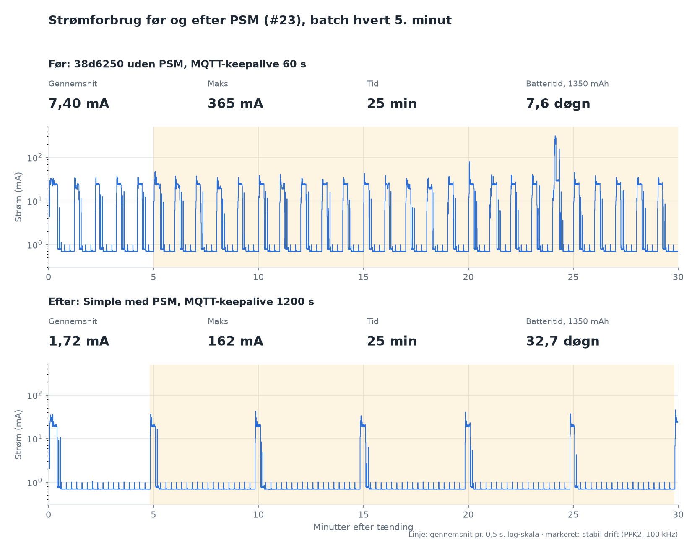
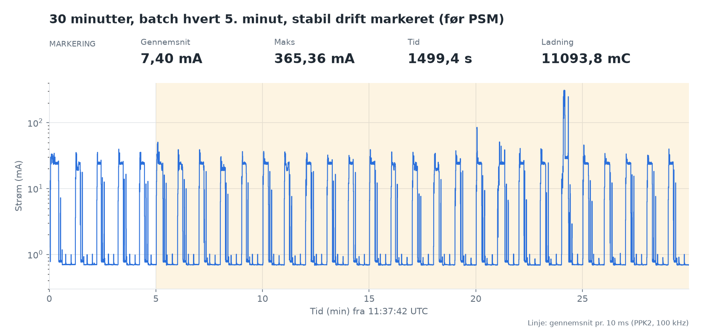
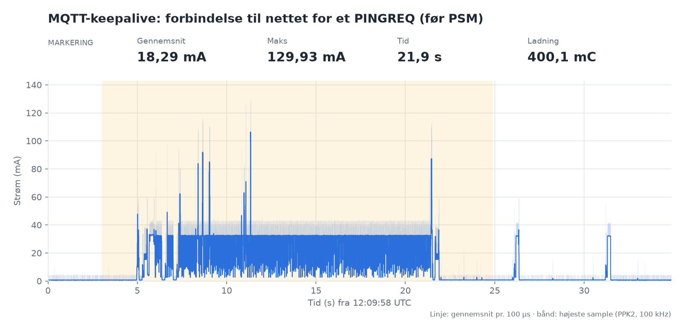
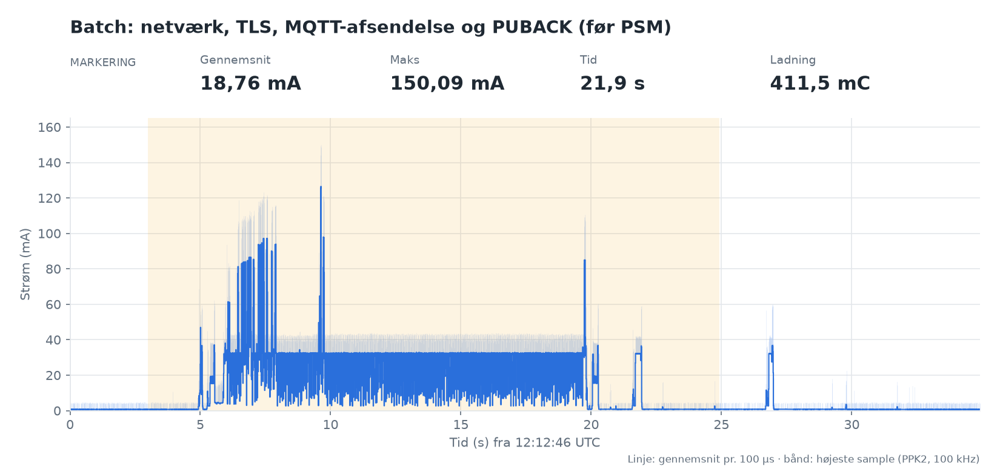
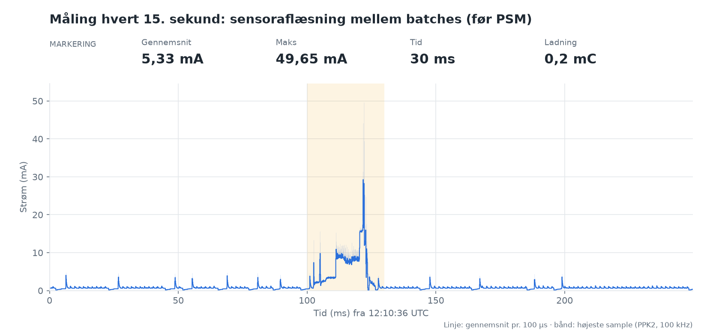
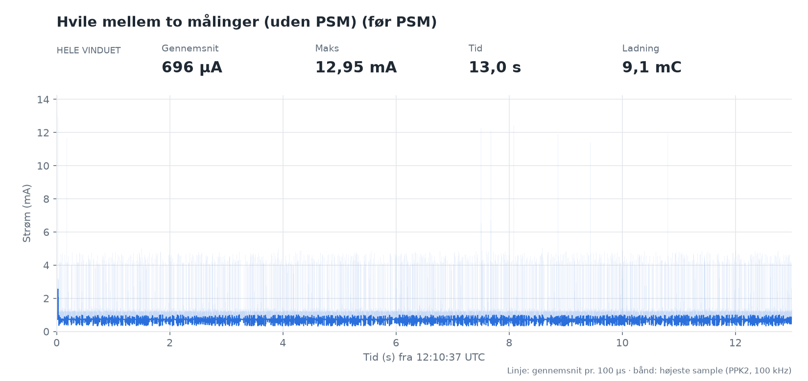
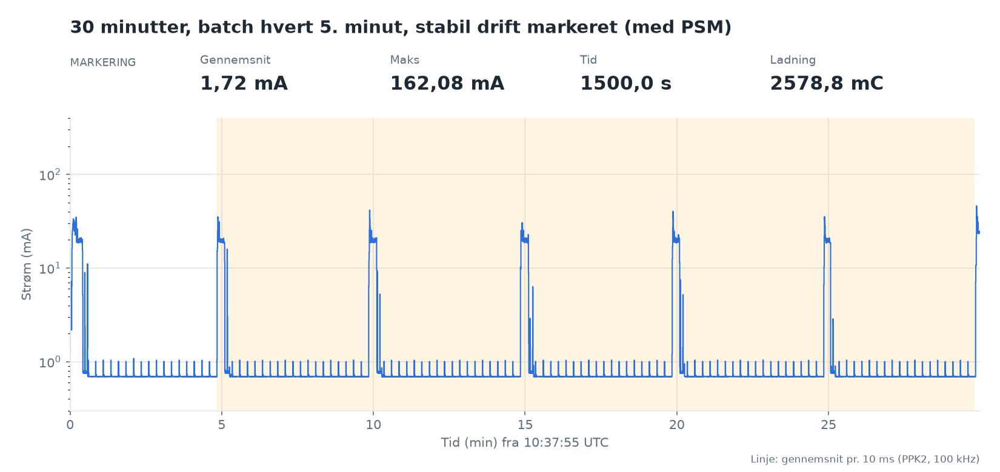
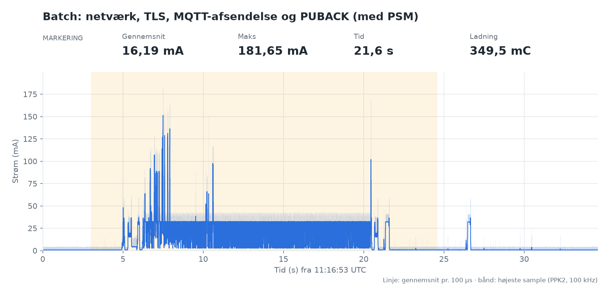
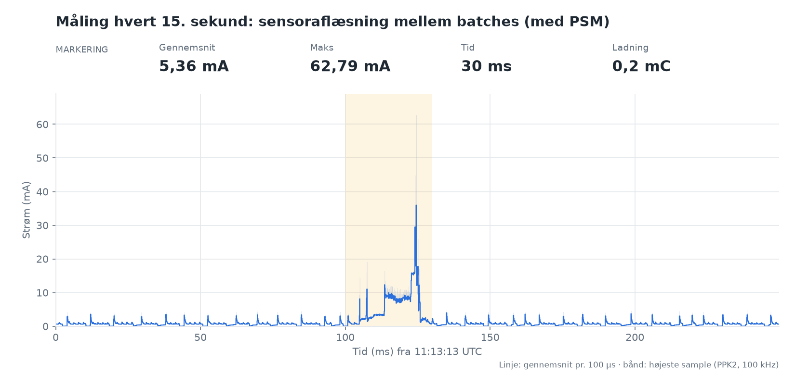
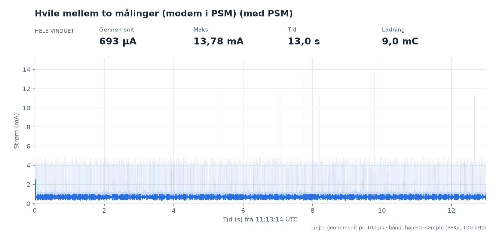

# Strømforbrug målt med PPK2 (#99)

En letlæst oversigt over forbedringen før og efter, med grafer, findes i
[stroemforbrug.html](stroemforbrug.html) (åbn filen i en browser). Den bygges med
`python3 Simple/scripts/ppk2/build_report.py`.

Dette dokument viser, hvor meget strøm Thingy:91 X bruger med Simple-firmwaren
og standardprofilen (batch hvert 5. minut). Målingen er lavet med Nordics Power
Profiler Kit II (PPK2) og supplerer [dataforbrug.md](dataforbrug.md) (#32).

## Resultat

| | |
| --- | --- |
| **Middelstrøm, stabil drift** | **1,72 mA** (25 min, 5 hele batchperioder) |
| Batteritid med 1350 mAh | ca. 785 timer = **33 døgn** (teoretisk, se forbehold) |
| Hvilestrøm mellem batches | 0,69 mA (median), laveste 1 % 0,58 mA |
| Måling hvert 15. sekund | ca. 25 ms, 5,4 mA i gns., 0,2 mC |
| Batch (forbindelse, TLS, MQTT, PUBACK) | 14,4 s over 20 mA, 298 mC, spids 162 mA |
| Højeste spids i hele målingen | 170 mA (opstart, 10 µs-sample) |
| Opstart fra slukket til første batch | 23 s, 507 mC |

## Før og efter PSM (#23)

Samme opstilling og samme profil (måling hvert 15. sekund, batch hvert 5.
minut), men med firmwaren fra commit `38d6250`, lige før PSM og sleep blev
indført i #23. Den forbinder og sender som normalt; VPS'en modtog alle fem
batches.

| | Før (`38d6250`) | Efter (Simple) |
| --- | --- | --- |
| PSM | nej | ja (TAU 3600 s, aktiv tid 10 s) |
| MQTT-keepalive | 60 s | 1200 s |
| Radio vågner | hvert minut | hvert 5. minut |
| **Middelstrøm, stabil drift (25 min)** | **7,40 mA** | **1,72 mA** |
| Batteritid, 1350 mAh (teoretisk) | 7,6 døgn | 32,7 døgn |
| Andel af tiden over 20 mA | 16 % | 2,6 % |
| Hvilestrøm | 0,73 mA | 0,69 mA |
| Højeste spids | 365 mA | 162 mA |



**Det viser sammenligningen:**

- **Strømforbruget er 4,3 gange lavere efter #23.** Batteritiden går fra ca. en
  uge til ca. en måned.
- **Forskellen er MQTT-keepalive, ikke hvilen.** Med keepalive på 60 s skal
  modemmet forbinde til nettet hvert minut for at sende et PINGREQ. Hver gang
  koster det lige så meget som en batch (ca. 300 mC), fordi radioen bliver
  forbundet i ca. 15 s, før nettet frigiver den. Det er fem gange flere
  radioforbindelser end nødvendigt.
- **Hvilestrømmen er næsten den samme** (0,73 mod 0,69 mA). Den er domineret af
  resten af boardet, ikke af modemmet; se *Hvile* nedenfor.
- Ved 24 minutter tog én keepalive 24 s med spidser op til 365 mA og 1,6 C
  ladning, sandsynligvis på grund af dårligere radioforhold i det øjeblik.
  Uden den ville gennemsnittet før være ca. 6,6 mA; forskellen er stadig
  ca. 4 gange.

Rådata: [før, 1 s-vinduer](assets/ppk2/foer-psm-38d6250-2026-11-19.csv).

### Grafer før PSM

Samme slags grafer som for Simple nedenfor, så de kan sammenlignes én til én.
Detaljegraferne er fra en separat optagelse 12:07:50 til 12:13:30 UTC i
100 µs-opløsning.

**Hele målingen før.** Radioen vågner hvert minut: fire keepalives og én batch
pr. 5 minutter.



**Én keepalive før.** Kun et MQTT-PINGREQ på få bytes, men radioen er forbundet
i ca. 17 s og bruger 400 mC, lige så meget som en batch.



**Én batch før.** Næsten samme forløb og ladning som efter (411 mod 350 mC).
Selve afsendelsen er ikke blevet billigere; den sker bare sjældnere end
radioens opvågninger før.



**Én måling før.** Uændret: ca. 25 ms og 0,2 mC.



**Hvile før.** 0,70 mA, samme niveau og samme impulser som efter. Uden PSM er
modemmet i RRC-idle mellem keepalives, men det koster ikke målbart mere end
PSM i de 13 s; besparelsen kommer fra, at radioen ikke skal forbinde hvert
minut.



## Grafer efter (Simple med PSM)

Graferne viser PPK2-målingen som i Power Profiler: strømmen over tid og en
markering med gennemsnit, maks, tid og ladning. Linjen er gennemsnittet, og det
lyse bånd er den højeste sample (10 µs) i samme tidsrum.

**Hele målingen.** De første 5 minutter er opstarten; de næste 25 minutter
(markeret) er stabil drift med fem batches. Mellem batches ses en lille spids
for hver måling hvert 15. sekund.



**Én batch.** Modemmet vågner, forbinder til netværket, laver TLS-handshake,
sender NDATA og venter på PUBACK. Radioen trækker 20 til 30 mA, mens den er
forbundet, med spidser op til 180 mA under afsendelsen. Efter ca. 16 s frigives
forbindelsen; de korte spidser bagefter er modemmets afslutning af
forbindelsen. Markeringen omfatter hele forløbet inklusive afslutningen, derfor
er ladningen lidt større end gennemsnittet i tabellen.



**Én måling.** CPU'en vågner, læser temperatur og batteri og lægger målingen i
bufferen. Det tager ca. 25 ms og koster 0,2 mC; 20 målinger pr. periode er
ca. 4 mC ud af 516 mC.



**Hvile.** Mellem målingerne ligger strømmen på 0,69 mA. Hvilestrømmen består
af korte impulser på ca. 3 mA med få millisekunders mellemrum, ikke af et jævnt
niveau. Det tyder på en periodisk kilde på boardet, fx PWM til LED'en eller en
regulator; en måling med LED'en slukket kan afgøre det.



### Fordeling pr. 5-minutters periode

| Del | Ladning | Andel |
| --- | --- | --- |
| Batch (radio aktiv) | 298 mC | 58 % |
| Hvile og målinger | 218 mC | 42 % |
| **I alt** | **516 mC** (= 1,72 mA × 300 s) | |

Hvilen er 0,69 mA × 300 s ≈ 207 mC; de 20 målinger pr. periode giver kun ca.
4 mC tilsammen. De resterende ca. 8 mC er korte radiospidser (op til 59 mA)
omkring 20 sekunder efter batchen, når modemmet frigiver forbindelsen.

### Det viser tallene

- **Batchen er den største post.** Selve afsendelsen fylder kun 2,6 % af tiden,
  men står for over halvdelen af forbruget, fordi radioen trækker 20 til 160 mA i
  ca. 15 sekunder.
- **Modemmet sover mellem batches.** Strømmen falder til et fladt niveau på
  0,69 mA få sekunder efter PUBACK og ligger der, indtil næste batch. Der er ingen
  radioaktivitet mellem batches, heller ikke keepalive, da MQTT-keepalive er
  1200 s.
- **Hvilestrømmen er ikke modemmet.** Et nRF91-modem i PSM bruger få µA. De
  0,69 mA er resten af boardet: nRF5340, sensorer, PMIC og LED'en, som lyser
  grønt, mens enheden er forbundet. En ny måling med `CONFIG_AITSM_LED=n` vil
  vise, hvor meget LED'en udgør.
- **Målingerne hvert 15. sekund koster næsten intet** (under 1 % af forbruget).
- Ingest på VPS'en modtog batchen 2 til 4 sekunder efter, at radioen startede.

## Sammenhold med dataforbrug (#32)

| Profil | Data pr. time | Gns. leveringstid | Strøm |
| --- | --- | --- | --- |
| `single` | ca. 66 KB | 2,1 s | ikke målt |
| `batch1` | ca. 33 KB | 25 s | ikke målt |
| **`batch5`** (Simple) | **ca. 16 KB** | **146 s** | **1,72 mA** |
| `batch8` | ca. 16 KB | 235 s | ikke målt |

Kun Simple med `batch5` er målt; de øvrige profiler findes kun i Original. En
batch koster ca. 300 mC uanset de 20 målinger. Sendte enheden hver måling for
sig med samme omkostning pr. afsendelse, ville batchdelen blive 20 gange større.
Det er et overslag, ikke en måling, men det støtter, at batch er det rigtige valg.

**Anbefaling:** Batch hvert 5. minut bekræftes som standard. Den giver ca. en
måneds batteritid, 16 KB data i timen og under 5 minutters leveringstid.

## Testbetingelser

| | |
| --- | --- |
| Dato og tid | 2026-11-19, 10:37:55 til 11:07:55 UTC |
| Enhed | Thingy:91 X (nRF9151), NB-IoT, stationær på indendørs bord |
| Firmware | Simple fra `main` (`c01a181`; Simple-appen senest ændret i `2deed06`), uden ændringer, LED slået til (`CONFIG_AITSM_LED=y`) |
| Profil | måling hvert 15. sekund, batch hvert 5. minut (20 målinger) |
| PSM | anmodet TAU 3600 s og aktiv tid 10 s; de tildelte timere er ikke logget under målingen |
| MQTT | TLS, QoS 1, keepalive 1200 s, SparkplugB NBIRTH + NDATA |
| Forsyning | Thingy'ens eget Li-Po-batteri (1350 mAh); USB ikke tilsluttet |
| PPK2-opstilling | ampere meter: batteri på VIN, Thingy på VOUT, fælles GND |
| Opløsning | 100 000 samples/s, gemt som 10 ms-gennemsnit og -maksimum |
| Rådata | [1 s-vinduer som CSV](assets/ppk2/simple-batch5-2026-11-19.csv) |
| Før-måling | firmware `38d6250`, 2026-11-19 11:37:42 til 12:07:42 UTC, samme opstilling |
| Detaljegrafer | separat optagelse 11:11:08 til 11:16:38 UTC med 100 µs-opløsning, samme opstilling |

## Forbehold

- **Batteritiden er teoretisk.** Den regner med hele 1350 mAh ved stuetemperatur.
  Batteriets aldring, kulde, selvafladning og PMIC'ens tab gør den reelle tid
  kortere.
- **Signalstyrken er ikke logget.** Med dårligere dækning varer batchen længere,
  og modemmet sender med højere effekt.
- **Én måling på 30 minutter.** Tallene for de fem batches ligger tæt (272 til
  332 mC), men lange udfald eller reconnects er ikke med.
- **Kun NB-IoT.** LTE-M er ikke målt, fordi projektet kører på NB-IoT.
- Målingen starter med en kold opstart; den er regnet for sig og ikke med i
  middelstrømmen.

## Sådan gentages målingen

```bash
python3 -m venv .venv && .venv/bin/pip install -r Simple/scripts/ppk2/requirements.txt
# PPK2 i ampere meter: batteri på VIN, Thingy på VOUT. Find porten med
# ls /dev/serial/by-id/ (brug PPK2'ens første interface, if01).
.venv/bin/python Simple/scripts/ppk2/measure.py /dev/ttyACM0 1800 maaling.csv --power-on
.venv/bin/python Simple/scripts/ppk2/analyze.py maaling.csv <start_epoch fra measure.py>
```

Graferne laves med `capture.py` (100 µs-opløsning, mindst 6 minutter) og
`plot.py`:

Sammenligningen før og efter laves med `compare.py` ud fra to CSV-filer fra
`measure.py` og hver måling sit tidsrum for stabil drift (sekunder):

```bash
.venv/bin/python Simple/scripts/ppk2/compare.py foer-efter.png \
  foer.csv "Før" 300.6 1800 efter.csv "Efter" 289.2 1789.2
```

```bash
.venv/bin/python Simple/scripts/ppk2/capture.py /dev/ttyACM0 360 fine.bin
.venv/bin/python Simple/scripts/ppk2/plot.py fine.bin <start_epoch> docs/assets/ppk2 prefix=efter- "version= (med PSM)"
.venv/bin/python Simple/scripts/ppk2/plot.py maaling.csv <start_epoch> docs/assets/ppk2 <start_s> <slut_s> prefix=efter- "version= (med PSM)"
# Før PSM: batchen ligger efter ca. 290 s, en keepalive efter 120 s og en måling efter 165 s
.venv/bin/python Simple/scripts/ppk2/plot.py foer.bin <start_epoch> docs/assets/ppk2 prefix=foer- "version= (før PSM)" \
  batch_at=290 keepalive_at=120 wake_at=165 psm=0
```

Scripts sætter PPK2'en i ampere meter, inden de tænder for VOUT, så
PPK2'ens egen forsyning aldrig kobles til Thingy'en.
